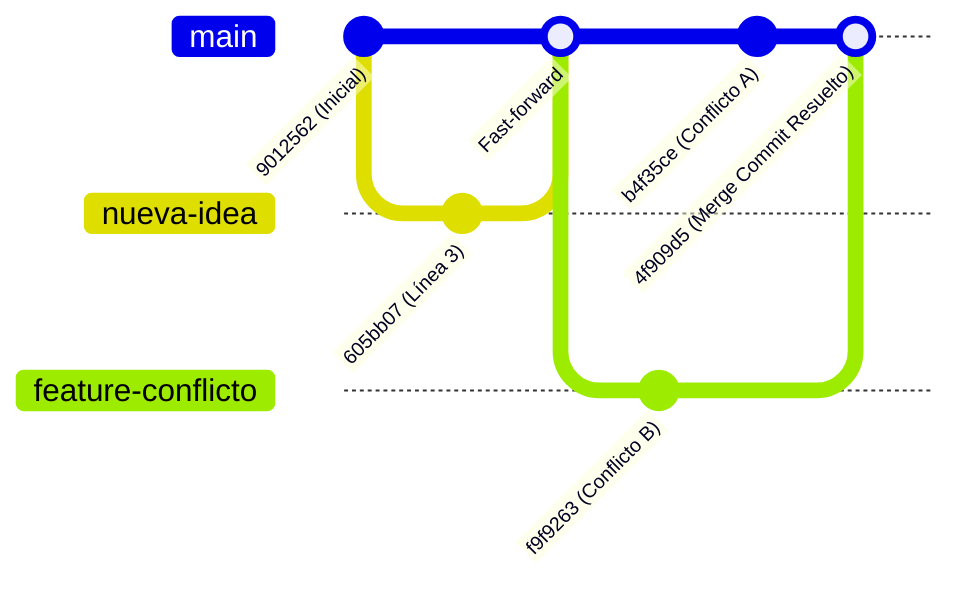

# Práctica de Git: Aprendizaje Interactivo de Branches y Git Graph

**Alumno:** Aitor Portales  
**Curso / Módulo:** Aplicaciones Web / Ofimática (APOF)  
**Centro:** CC Sant Josep Obrer  
**Fecha:** Noviembre 2026  

---

## Índice de Contenidos

1. [Parte 1: GIT - Aprendizaje Interactivo (Terminal y Comandos)](#parte-1-git---aprendizaje-interactivo)
   - [1. Introducción guiada](#1-introducción-guiada)
   - [2. Primer reto: Crear una rama](#2-primer-reto-crear-una-rama)
   - [3. Cambiar de rama](#3-cambiar-de-rama)
   - [4. Confirmar cambios en la rama](#4-confirmar-cambios-en-la-rama)
   - [5. Fusionar ramas](#5-fusionar-ramas)
   - [6. Reflexión y dudas: Gestión de conflictos](#6-reflexión-y-dudas-gestión-de-conflictos)
2. [Parte 2: Branches en Git con Git Graph (Entorno Visual VS Code)](#parte-2-branches-en-git-con-gitgraph)
   - [1. Instalar y abrir Git Graph](#1-instalar-y-abrir-git-graph)
   - [2. Crear una nueva rama desde el menú](#2-crear-una-nueva-rama-desde-el-menú)
   - [3. Cambiarte a la nueva rama](#3-cambiarte-a-la-nueva-rama)
   - [4. Hacer cambios y confirmarlos (commit) usando menús](#4-hacer-cambios-y-confirmarlos-commit-usando-menús)
   - [5. Cambiar de rama usando el menú](#5-cambiar-de-rama-usando-el-menú)
   - [6. Fusionar ramas usando el menú](#6-fusionar-ramas-usando-el-menú)
   - [7. Explora y experimenta: Resolución visual de conflictos](#7-explora-y-experimenta-resolución-visual-de-conflictos)
   - [8. Ver el historial de commits](#8-ver-el-historial-de-commits)
   - [9. Ventajas del método visual frente a la terminal](#ventajas-de-este-método)
3. [Registro de Ejecución Real en el Repositorio](#registro-de-ejecución-real-en-el-repositorio)

---

# Parte 1: GIT - Aprendizaje Interactivo

### **Cómo funciona el sistema interactivo:**
- **Guía paso a paso:** Se formulan preguntas técnicas, se ejecutan comandos reales, se analizan los resultados en el directorio de trabajo y se reflexiona sobre los punteros de Git.
- **Resolución de dudas:** Se acompañan las explicaciones con diagramas de flujo y mapas de commits.
- **Retos prácticos:** Se ejecutan situaciones reales de ramificación, aislamiento, avance rápido (*fast-forward*) y resolución manual de conflictos.

---

### **1. Introducción guiada**

> *¿Sabías que en Git puedes trabajar en varias versiones de tu proyecto al mismo tiempo usando "ramas"? ¿Te gustaría probar cómo funciona?*

#### **Pregunta 1: ¿Qué crees que pasaría si pudieras hacer cambios sin afectar el trabajo principal?**
**Respuesta:**  
Poder trabajar en ramas aisladas proporciona tres grandes ventajas en el desarrollo de software:
1. **Seguridad y estabilidad:** La rama principal (`main` o `master`) permanece siempre limpia, funcional y libre de errores o pruebas a medias. Si un experimento no funciona, se descarta la rama sin que el código de producción se vea alterado.
2. **Desarrollo en paralelo:** Varios desarrolladores (o un mismo desarrollador en diferentes tareas) pueden trabajar a la vez en distintas funcionalidades (*features*), correcciones de errores (*bugfixes*) o pruebas de concepto sin pisarse el trabajo entre sí.
3. **Revisión y control de calidad:** Permite revisar, auditar y probar a fondo una funcionalidad antes de decidir incorporarla de manera definitiva al proyecto principal.

#### **Pregunta 2: ¿Te animas a crear una rama y experimentar?**
**Respuesta:**  
Sí. En Git, una rama no es una copia pesada de toda la carpeta del proyecto, sino un **puntero móvil muy ligero** (un simple archivo de apenas 41 bytes que contiene el hash SHA-1 del commit correspondiente). Crear y alternar ramas en Git es instantáneo y muy eficiente.

---

### **2. Primer reto: Crear una rama**

#### **Instrucción:**
Abre tu terminal en la carpeta del proyecto y ejecuta:
```bash
git branch nueva-idea
```

#### **Pregunta: ¿Qué crees que ha pasado?**
**Respuesta:**  
Git ha creado una nueva referencia llamada `nueva-idea` que apunta exactamente al mismo commit donde nos encontrábamos en ese instante (`HEAD`).  
Internamente, Git ha escrito el archivo `.git/refs/heads/nueva-idea` con el hash del último commit. Sin embargo, **aún no nos hemos movido a esa rama**; seguimos posicionados en la rama `main`.

---

#### **Instrucción:**
Ahora, escribe:
```bash
git branch
```

#### **Salida real obtenida en la consola:**
```text
* main
  nueva-idea
```

#### **Pregunta: ¿Ves la nueva rama en la lista? ¿Cuál está marcada con un asterisco (*)?**
**Respuesta:**  
- **Sí, aparecen ambas ramas:** `main` y `nueva-idea`.
- **La rama marcada con el asterisco (`*`) es `main`** (y habitualmente se muestra en color verde en la terminal).  
El asterisco indica cuál es la **rama activa actual**, es decir, hacia dónde apunta la referencia especial `HEAD`. Aunque la rama `nueva-idea` ya existe en el repositorio, cualquier nuevo archivo o cambio que confirmáramos en este momento seguiría perteneciendo a `main`.

---

### **3. Cambiar de rama**

#### **Instrucción:**
Ahora, cambiemos a la nueva rama:
```bash
git checkout nueva-idea
```
*(Nota técnica: En versiones modernas de Git también se puede usar el comando equivalente `git switch nueva-idea`).*

#### **Salida en consola:**
```text
Switched to branch 'nueva-idea'
```

#### **Pregunta: ¿Notas algún cambio en tus archivos?**
**Respuesta:**  
**No se aprecia ningún cambio en los archivos.**  
Esto se debe a que la rama `nueva-idea` parte del mismo commit exacto que `main`. Ambos punteros apuntan al mismo árbol de objetos (*tree*). Lo único que ha cambiado es el puntero `HEAD`, que ahora apunta a `refs/heads/nueva-idea`.

---

#### **Instrucción:**
Haz una pequeña modificación en un archivo y guárdalo. En nuestro caso, añadimos una nueva línea al archivo `proyecto.txt`:
```text
Línea 3: Esta es una nueva funcionalidad experimental desarrollada en nueva-idea.
```

Luego, escribe:
```bash
git status
```

#### **Salida en consola:**
```text
On branch nueva-idea
Changes not staged for commit:
  (use "git add <file>..." to update what will be committed)
  (use "git restore <file>..." to discard changes in working directory)
	modified:   proyecto.txt

no changes added to commit (use "git add" and/or "git commit -a")
```

#### **Pregunta: ¿Qué ves? ¿Qué crees que pasaría si confirmas este cambio?**
**Respuesta:**  
- **Lo que vemos:** Git nos informa de que estamos en la rama `nueva-idea` y que `proyecto.txt` ha sido modificado en el directorio de trabajo (*Working Directory*), pero aún no ha sido añadido al área de preparación (*Staging Area / Index*).
- **Qué pasará al confirmar el cambio:** Al hacer commit, se creará un nuevo objeto commit con los cambios introducidos. El puntero de la rama `nueva-idea` avanzará automáticamente hacia ese nuevo commit. La rama `main`, en cambio, se quedará fija en el commit anterior. En ese punto, las historias de ambas ramas comenzarán a divergir.

---

### **4. Confirmar cambios en la rama**

#### **Instrucción:**
Añade y confirma el cambio:
```bash
git add .
git commit -m "Cambio en la rama nueva-idea"
```

#### **Salida en consola:**
```text
[nueva-idea 605bb07] Cambio en la rama nueva-idea
 1 file changed, 1 insertion(+)
```

Ahora, vuelve a la rama principal:
```bash
git checkout main
```

#### **Salida en consola:**
```text
Switched to branch 'main'
```

Comprobamos el contenido del archivo con `Get-Content .\proyecto.txt` (o `cat proyecto.txt`):
```text
Proyecto Principal - Versión Inicial
Línea 1: Esta es la base estable del proyecto.
Línea 2: Todo el equipo trabaja sobre esta versión.
```

#### **Pregunta: ¿El cambio que hiciste sigue ahí?**
**Respuesta:**  
**¡No, el cambio no está! La línea añadida ha desaparecido.**  
Al ejecutar `git checkout main`, Git actualiza automáticamente el sistema de archivos del espacio de trabajo para que coincida con el estado exacto del último commit de `main`.  
El cambio que realizamos está a salvo guardado en el commit `605bb07` de la rama `nueva-idea`. Esto demuestra de forma práctica el aislamiento total: podemos realizar experimentos radicales en una rama sin riesgo de alterar el trabajo de la rama principal.

---

### **5. Fusionar ramas**

> *¿Te gustaría juntar el trabajo de la rama "nueva-idea" con el principal?*

#### **Instrucción:**
Primero, asegúrate de estar en la rama principal:
```bash
git checkout main
```
Luego, escribe:
```bash
git merge nueva-idea
```

#### **Salida en consola:**
```text
Updating 9012562..605bb07
Fast-forward
 proyecto.txt | 1 +
 1 file changed, 1 insertion(+)
```

Comprobamos de nuevo el contenido del archivo:
```text
Proyecto Principal - Versión Inicial
Línea 1: Esta es la base estable del proyecto.
Línea 2: Todo el equipo trabaja sobre esta versión.
Línea 3: Esta es una nueva funcionalidad experimental desarrollada en nueva-idea.
```

#### **Pregunta: ¿Qué ha pasado? ¿Ves el cambio ahora en la rama principal?**
**Respuesta:**  
- **Sí, el cambio ahora aparece reflejado en `main`.**
- **Mecanismo de fusión:** Git ha realizado una fusión de tipo **Fast-forward** (avance rápido).  
  Esto ocurre porque `main` no tenía ningún commit nuevo desde el momento en que creamos `nueva-idea`. En lugar de necesitar crear un commit de fusión intermedio, a Git le basta con mover el puntero de `main` hacia adelante, colocándolo directamente en el commit `605bb07` de `nueva-idea`.

---

### **6. Reflexión y dudas: Gestión de conflictos**

#### **Pregunta de reflexión: ¿Te gustaría probar qué pasa si hay conflictos?**
**Demostración práctica de conflicto:**  
Un conflicto de fusión (*Merge Conflict*) se produce cuando dos ramas han modificado **las mismas líneas de un mismo archivo** de forma diferente y Git no puede decidir automáticamente cuál de las dos versiones es la correcta.

#### **Simulación realizada:**
1. En una rama alternativa (`feature-conflicto`), editamos la Línea 3:
   ```text
   Línea 3: Versión modificada desde la rama conflicto.
   ```
   Hacemos commit: `git commit -am "Modificación de la línea 3 en feature-conflicto"`
2. Volvemos a `main` y editamos exactamente la misma Línea 3 con otro texto:
   ```text
   Línea 3: Versión modificada de forma diferente directamente en main.
   ```
   Hacemos commit: `git commit -am "Modificación concurrente de la línea 3 en main"`
3. Intentamos fusionar: `git merge feature-conflicto`.

#### **Resultado del intento de fusión:**
```text
Auto-merging proyecto.txt
CONFLICT (content): Merge conflict in proyecto.txt
Automatic merge failed; fix conflicts and then commit the result.
```

#### **Marcadores de conflicto insertados por Git en el archivo:**
```text
Proyecto Principal - Versión Inicial
Línea 1: Esta es la base estable del proyecto.
Línea 2: Todo el equipo trabaja sobre esta versión.
<<<<<<< HEAD
Línea 3: Versión modificada de forma diferente directamente en main.
=======
Línea 3: Versión modificada desde la rama conflicto.
>>>>>>> feature-conflicto
```

#### **Estructura de las marcas:**
- `<<<<<<< HEAD`: Comienzo del bloque con el contenido de la rama en la que nos encontramos (`main`).
- `=======`: Divisor entre ambas versiones en pugna.
- `>>>>>>> feature-conflicto`: Fin del bloque con el contenido de la rama que intentamos fusionar.

#### **Resolución del conflicto:**
El desarrollador debe editar manualmente el archivo, eliminar las marcas de conflicto y consensuar el resultado final:
```text
Proyecto Principal - Versión Inicial
Línea 1: Esta es la base estable del proyecto.
Línea 2: Todo el equipo trabaja sobre esta versión.
Línea 3: Versión unificada y consensuada que combina los cambios de main y feature-conflicto.
```
Una vez resuelto:
```bash
git add proyecto.txt
git commit -m "Merge branch 'feature-conflicto' - Conflicto resuelto unificando ambas ramas"
```

#### **Diagrama de la evolución de las ramas:**


---

# Parte 2: Branches en Git con GitGraph

### **1. Instalar y abrir Git Graph**

1. Abre **Visual Studio Code**.
2. Abre la vista de Extensiones pulsando el icono de cuadrados en la barra lateral o con el atajo `Ctrl + Shift + X`.
3. Escribe en el buscador: `Git Graph` (desarrollada por mhutchie).
4. Haz clic en **Install**.
5. Para abrir la extensión:
   - Haz clic en el botón **Git Graph** en la barra de estado inferior de VS Code.
   - O bien abre la vista de **Source Control** (`Ctrl + Shift + G`) y haz clic en el icono con forma de diagrama de ramas que aparece en la parte superior.

---

### **2. Crear una nueva rama desde el menú**

1. En la ventana central de Git Graph, localiza el nodo del commit donde se encuentra la rama `main`.
2. Haz **clic derecho** sobre la etiqueta de la rama `main` o sobre el commit deseado.
3. En el menú contextual, pulsa en **"Create Branch Here..."**.
4. Escribe el nombre de la nueva rama, por ejemplo: `nueva-idea`.
5. Si deseas cambiar inmediatamente a ella, marca la casilla *"Check out"* o presiona Enter.

#### **Pregunta de reflexión: ¿Ves cómo aparece la nueva rama en el gráfico?**
**Respuesta:**  
En Git Graph aparece inmediatamente una nueva etiqueta rectangular con el nombre `nueva-idea` situada justo al lado de la etiqueta `main` sobre el mismo círculo de commit. Esto muestra de forma gráfica e intuitiva que ambas ramas apuntan exactamente al mismo punto del historial antes de divergir.

---

### **3. Cambiarte a la nueva rama**

1. En el gráfico de Git Graph, haz **clic derecho** sobre la etiqueta `nueva-idea`.
2. Selecciona la opción **"Checkout This Branch"**.

#### **Observación:**
- En Git Graph, el texto de la etiqueta `nueva-idea` se resalta en **negrita** o con un borde destacado para indicar que es la rama activa actual (*HEAD*).
- En la esquina inferior izquierda de la ventana de VS Code, en la barra de estado azul, el indicador de rama muestra ahora `nueva-idea`.

---

### **4. Hacer cambios y confirmarlos (commit) usando menús**

1. Abre cualquier archivo en el editor de VS Code (por ejemplo, `proyecto.txt`), añade o modifica código y pulsa `Ctrl + S` para guardar.
2. Dirígete a la barra lateral izquierda y abre la pestaña **Source Control** (Control de código fuente, `Ctrl + Shift + G`).
3. El archivo aparecerá en la sección *Changes* con una letra `M` (Modified).
4. Escribe un mensaje descriptivo en el campo de texto superior (por ejemplo: `Cambio en nueva-idea`).
5. Haz clic en el botón azul **Commit** (o en el icono de marca de verificación `✓`). VS Code preguntará si deseas añadir los cambios al área de preparación automáticamente si no lo habías hecho previamente.

#### **Regreso a Git Graph: ¿Ves el nuevo commit en la rama `nueva-idea`?**
**Respuesta:**  
Al volver a la pestaña de Git Graph, se observa que se ha dibujado un nuevo círculo encima del anterior. La etiqueta `nueva-idea` se ha desplazado hacia ese nuevo commit, mientras que la etiqueta `main` permanece anclada en el commit inferior. Una línea vertical conecta ambos estados.

---

### **5. Cambiar de rama usando el menú**

1. En Git Graph, haz **clic derecho** sobre la etiqueta de la rama `main`.
2. Selecciona **"Checkout This Branch"**.

#### **Observación:**
- El archivo que teníamos abierto en el editor de VS Code se actualiza en pantalla automáticamente: las líneas que habíamos escrito en la rama `nueva-idea` desaparecen al instante.
- El indicador de la barra de estado vuelve a reflejar que estamos en `main`.

---

### **6. Fusionar ramas usando el menú**

1. Estando situados en `main` (comprobando que `main` esté en negrita), busca en el gráfico la rama `nueva-idea`.
2. Haz **clic derecho** sobre la etiqueta `nueva-idea`.
3. Selecciona **"Merge into Current Branch..."**.
4. Aparece un cuadro de diálogo con opciones como *Create a new commit even if fast-forward is possible* (crear commit aunque sea fast-forward) o *Squash*. Dejamos las opciones estándar y confirmamos pulsando **Yes, merge**.

#### **Observación:**
- Si la fusión es *Fast-forward*, la etiqueta `main` se desplaza hacia arriba hasta colocarse al mismo nivel que `nueva-idea`.
- Los cambios realizados en `nueva-idea` vuelven a estar visibles en el archivo abierto en el editor de código.

---

### **7. Explora y experimenta: Resolución visual de conflictos**

Si se produce un conflicto entre ramas:
1. Git Graph mostrará un aviso de fusión interrumpida y un estado de *Uncommitted Changes*.
2. Al abrir la pestaña de **Source Control**, los archivos en conflicto aparecen bajo la categoría **Merge Changes** con un icono de advertencia rojo (`!`).
3. Al hacer clic en el archivo en conflicto, VS Code abre el potente **Merge Editor**:
   - En la parte superior izquierda se muestra la versión de la rama actual (*Current* / `main`).
   - En la parte superior derecha se muestra la versión de la rama entrante (*Incoming* / `feature`).
   - En la parte inferior se muestra el resultado final (*Result*).
4. El usuario puede pulsar los botones interactivos:
   - **Accept Current:** Conserva los cambios de la rama principal.
   - **Accept Incoming:** Sobrescribe con los cambios de la rama secundaria.
   - **Accept Both:** Incluye ambos bloques de código.
5. Tras revisar el resultado, se pulsa **Complete Merge** y se confirma el commit con el botón de check (`✓`).

---

### **8. Ver el historial de commits**

- En la vista de Git Graph, cada fila representa un commit con su código hash abreviado, mensaje, autor, fecha y diagrama de líneas coloreadas.
- Al hacer clic sobre cualquier commit:
  - Se despliega un panel inferior con la lista completa de archivos afectados.
  - Al hacer clic sobre cualquiera de esos archivos, VS Code abre una **vista comparativa en paralelo (*Diff View*)**, resaltando en verde las líneas añadidas y en rojo las eliminadas.

---

## **Ventajas de este método**

| Característica | Git Graph / Interfaz Visual | Terminal de Comandos |
| :--- | :--- | :--- |
| **Curva de aprendizaje** | Muy accesible para principiantes; aprendizaje visual e interactivo. | Requiere memorizar sintaxis y parámetros de comandos. |
| **Comprensión del estado** | Se observa de un vistazo dónde están todas las ramas y qué commits las componen. | Requiere ejecutar comandos como `git log --graph --oneline --all` y descifrar texto en consola. |
| **Prevención de errores** | Evita hacer merge sobre la rama incorrecta al ver claramente la posición de *HEAD*. | Si no se revisa `git branch`, es fácil realizar cambios sobre una rama equivocada. |
| **Resolución de conflictos** | Botones de selección directa en el editor (*Accept Current / Incoming*). | Modificación manual de texto buscando las marcas `<<<<<<<` y `>>>>>>>`. |
| **Inspección de diferencias** | Vista gráfica interactiva (*Side-by-side Diff*) con un solo clic. | Salida textual en consola mediante `git diff`. |
| **Entornos sin interfaz** | No disponible en servidores remotos headless (por ejemplo, servidores Linux en la nube). | Funciona en cualquier sistema operativo, terminal SSH o script automatizado (CI/CD). |

> [!TIP]
> **Conclusión pedagógica:** La extensión Git Graph en VS Code es una herramienta formativa de enorme valor para interiorizar cómo se ramifica y converge el historial de un proyecto. Complementar el uso visual con el dominio de los comandos básicos de terminal (`git branch`, `git checkout`/`switch`, `git merge`, `git status`) forma el perfil de un desarrollador completo.

---

# Registro de Ejecución Real en el Repositorio

A continuación se muestra el registro verbatim de los commits reales generados en este espacio de trabajo para completar y verificar cada paso de la práctica:

```text
PS C:\Users\AITORPORTALESCRESPI\OneDrive - CC Sant Josep Obrer I\Documentos\APOF\OpenSpec> git log --graph --oneline --all
*   4f909d5 (HEAD -> main) Merge branch 'feature-conflicto' - Conflicto resuelto unificando ambas ramas
|\  
| * f9f9263 (feature-conflicto) Modificación de la línea 3 en feature-conflicto
* | b4f35ce Modificación concurrente de la línea 3 en main
|/  
* 605bb07 (nueva-idea) Cambio en la rama nueva-idea
* 9012562 Commit inicial en la rama main
```
